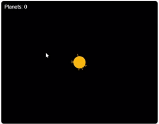

# Overview

A tiny universe in a browser tab: a gravity simulator made with [Three.js](https://threejs.org/), where every planet pulls on every other. Place them, fling them, and watch orbits form, wobble, and collide.

This project is the Three.js version of [m5core2_gravsim](https://github.com/cubic9com/m5core2_gravsim).

\[日本語\]

ブラウザのタブの中に広がる、小さな宇宙。このプロジェクトは[Three.js](https://threejs.org/)で作られた重力シミュレーターです。すべての惑星が互いに引き合います。惑星を配置し、勢いよく飛ばしてみよう。軌道が生まれ、揺らぎ、やがて衝突する。そのダイナミックな動きを楽しんでください。

このプロジェクトは [m5core2_gravsim](https://github.com/cubic9com/m5core2_gravsim) のThree.js版です。

# Video



# How to Use

1. Open [this page](https://cubic9com.github.io/threejs_gravsim/) in a browser.

\[日本語\]

1. [このページ](https://cubic9com.github.io/threejs_gravsim/) をブラウザで開きます。

# Installation for developers

1. Clone the repository:
    ```sh
    git clone https://github.com/cubic9com/threejs_gravsim.git
    cd threejs_gravsim
    ```

2. Open the project in Visual Studio Code:
    ```sh
    code .
    ```

\[日本語\]

1. リポジトリをクローンします:
    ```sh
    git clone https://github.com/cubic9com/threejs_gravsim.git
    cd threejs_gravsim
    ```

2. Visual Studio Code でプロジェクトを開きます:
    ```sh
    code .
    ```

# License

Copyright (C) 2025, cubic9com All rights reserved.

This project is licensed under the MIT license.

See the `LICENSE` file for details.

